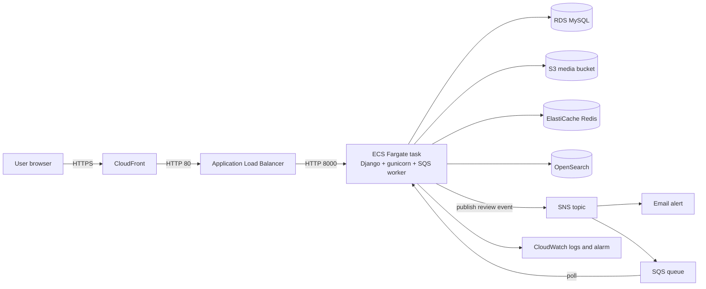

# DineWise – Restaurant Review Platform

A full-stack Django web application where people can discover restaurants, search and filter them (including by distance using browser geolocation), and post multi-criteria reviews. It also exposes a REST API and is deployed on AWS.

**Author:** Archana T A
**Code:** https://github.com/archanata2026-stack/Dine-wise-restaurant-reviewapp
**Live (AWS, HTTPS):** https://dulhma0zdbcpd.cloudfront.net
**Earlier deployment (PythonAnywhere):** https://dinewise.pythonanywhere.com

---

## 1. Features

| Area | What it does |
|---|---|
| Browse | Paginated restaurant list with image, city, cuisine, veg/non-veg, parking and average rating |
| Filter | By city, cuisine and food type (veg / non-veg / both); sort by highest rating |
| Cuisine page | Lists all cuisines (cached in Redis); each one links into the filtered list |
| Near me | Uses the browser Geolocation API; restaurants sorted by distance (Haversine formula) |
| Search | Full-text search (OpenSearch) over name, cuisine, city and description, with geo-distance sorting |
| Reviews | Logged-in users rate food quality, quantity and staff behaviour (1–5) and add a comment |
| Accounts | Sign up, log in, log out, profile picture upload |
| Detail page | Restaurant info, all reviews, average rating and review count |
| REST API | Full CRUD for restaurants and reviews, token authentication, filtering |
| Notifications | Every new review publishes an event (SNS) that sends an email and is queued (SQS) for a worker |
| Data import | Management command that imports restaurants from OpenStreetMap |
| SEO | `sitemap.xml`, `robots.txt`, per-page titles and meta descriptions, JSON-LD structured data |

---

## 2. Architecture



**Request flow for a page view:** browser → CloudFront (HTTPS, no caching) → ALB (health check `/health/`) → Fargate task running gunicorn → Django view → RDS (data), Redis (cached lists), S3 (image links).

**Flow when a user submits a review:**
1. The user posts the review form (or calls the API with a token).
2. The view validates the data, attaches the logged-in user and the restaurant from the URL, and saves the `Review` in MySQL.
3. `publish_review_event()` sends a JSON message to the SNS topic (wrapped in try/except so a messaging problem never blocks a review).
4. SNS fans the message out to an email subscription and to the SQS queue.
5. The `consume_reviews` worker long-polls SQS, logs the event to CloudWatch, and deletes the message.

---

## 3. AWS services and how each is used

Region: **ap-southeast-2 (Sydney)**.

| Service | Resource name | Role in the project |
|---|---|---|
| ECR | `dinewise` | Stores the Docker image |
| ECS on Fargate | cluster `dinewise-cluster`, service `dinewise-service`, task `dinewise-task` (0.25 vCPU, 0.5 GB) | Runs the container with gunicorn (2 workers) and the SQS worker |
| Application Load Balancer | `dinewise-alb`, target group `dinewise-tg` | Public entry point, health checks on `/health/`, forwards to the task on port 8000 |
| CloudFront | distribution commented "DineWise" | Free HTTPS address in front of the ALB (browsers only allow geolocation on HTTPS) |
| RDS MySQL | `dinewise-db` (db.t3.micro, private) | Production database, replaces SQLite |
| S3 | `dinewise-media-<account id>` (private) | Profile pictures and restaurant images, served through temporary signed URLs |
| SNS | topic `dinewise-review-events` | Publishes review events; also receives CloudWatch alarm notifications |
| SQS | queue `dinewise-review-queue` | Buffers review events for the worker |
| ElastiCache Redis | `dinewise-redis` (cache.t3.micro) | Django cache backend (cuisine list cached for 5 minutes) |
| OpenSearch | domain `dinewise-search` (t3.small.search, one node) | Full-text and geo-distance restaurant search (`geo_point` field) |
| IAM | `dinewise-execution-role`, `dinewise-task-role` | Execution role pulls the image and writes logs; the task role gives the app S3, SNS, SQS and OpenSearch access without any access keys in code |
| CloudWatch | log group `/ecs/dinewise` (7-day retention), alarm `dinewise-high-cpu` | Container logs; alarm on high CPU sends an email through SNS |
| VPC security groups | `dinewise-alb-sg`, `dinewise-ecs-sg`, `dinewise-db-sg`, `dinewise-redis-sg` | Internet → ALB (80) → app (8000) → database (3306) and Redis (6379); each layer only accepts traffic from the one in front |

---

## 4. Tech stack

Python 3.12, Django 5.2, Django REST Framework, MySQL (SQLite for local development), Bootstrap 5 with custom CSS, WhiteNoise (static files), gunicorn, Pillow, boto3 and django-storages, redis, opensearch-py, Docker.

---

## 5. Data model

- **Restaurant** – name, address, city, cuisine, food_type (`VEG` / `NON_VEG` / `BOTH`), has_parking, description, image, latitude, longitude, created_on. Methods: `average_rating()` (uses `Avg` aggregation), `review_count()`.
- **Review** – restaurant (ForeignKey, `related_name='reviews'`), user (ForeignKey), quality_rating, quantity_rating, staff_rating (1–5 choices), comment, created_at. Method: `average_rating()` for a single review.
- **Profile** – one-to-one with `User`, profile picture. Created automatically by a `post_save` signal when a user registers.

Relationships: one restaurant has many reviews; one user writes many reviews; one user has exactly one profile.

---

## 6. Web pages

| URL | Purpose |
|---|---|
| `/` | Restaurant list with filters, sorting (`?sort=rating`), Near me (`?lat=&lng=&radius=`), pagination |
| `/restaurant/<id>/` | Restaurant detail and reviews |
| `/restaurant/<id>/review/` | Add a review (login required) |
| `/cuisine/` | Browse by cuisine |
| `/search/?q=` | OpenSearch full-text search |
| `/signup/`, `/login/`, `/logout/` | Authentication |
| `/profile/edit/` | Change profile picture |
| `/admin/` | Django admin (manage restaurants, users, reviews) |
| `/health/` | Load balancer health check |
| `/sitemap.xml`, `/robots.txt` | SEO |

Web views are class-based, built on Django's base `View` class with explicit `get()` and `post()` methods.

---

## 7. REST API

Base path `/api/`. Reads are public; writes need a token.

| Method | Endpoint | Description | Auth |
|---|---|---|---|
| POST | `/api/token/` | Send `username` and `password`, receive a token | No |
| GET | `/api/restaurants/` | List restaurants (`?city=`, `?cuisine=`, `?food_type=`) | No |
| POST | `/api/restaurants/` | Create a restaurant | Token |
| GET | `/api/restaurants/<id>/` | Restaurant with reviews, average rating, review count | No |
| PUT/PATCH/DELETE | `/api/restaurants/<id>/` | Update or delete | Token |
| GET | `/api/restaurants/<id>/reviews/` | List reviews | No |
| POST | `/api/restaurants/<id>/reviews/` | Create a review (user and restaurant set by the server) | Token |
| GET | `/api/restaurants/<id>/reviews/<id>/` | One review | No |
| PUT/PATCH/DELETE | `/api/restaurants/<id>/reviews/<id>/` | Edit or delete (owner only) | Token |

Authenticated requests send the header `Authorization: Token <your_token>`. The API was tested with Postman (GET, POST, PUT, DELETE).

Example:

```bash
curl -X POST https://dulhma0zdbcpd.cloudfront.net/api/token/ \
  -H "Content-Type: application/json" \
  -d '{"username": "your_user", "password": "your_password"}'
```

---

## 8. Project structure

```
manage.py
Dockerfile, .dockerignore, entrypoint.sh, requirements.txt, restaurants.json
restaurant_review/        settings.py, urls.py, wsgi.py
restaurants/
    models.py             Restaurant, Review, Profile (+ signal)
    views.py              web views
    forms.py              ReviewForm, ProfileForm
    serializers.py        DRF serializers
    api_views.py          DRF generic views
    api_urls.py           /api/ routes
    urls.py               web routes
    events.py             SNS publisher
    search.py             OpenSearch client, indexing and search
    sitemaps.py, middleware.py (health check)
    management/commands/  import_osm, consume_reviews, index_restaurants
templates/                base.html, restaurant_list.html, restaurant_detail.html, search.html ...
static/                   css/style.css, images/
```

---

## 9. Configuration (environment variables)

The app reads configuration from the environment (or a local `.env` file), so no secrets are in the code.

| Variable | Purpose |
|---|---|
| `SECRET_KEY`, `DEBUG` | Django basics (`DEBUG=False` in production) |
| `ALLOWED_HOSTS`, `CSRF_TRUSTED_ORIGINS` | Comma-separated hosts and origins (ALB and CloudFront addresses) |
| `DB_ENGINE=mysql`, `DB_NAME`, `DB_USER`, `DB_PASSWORD`, `DB_HOST` | RDS connection. Without `DB_ENGINE` the app uses SQLite |
| `AWS_STORAGE_BUCKET_NAME` | Turns on S3 media storage. Without it, files go to local `media/` |
| `SNS_TOPIC_ARN`, `SQS_QUEUE_URL` | Review events |
| `REDIS_URL` | Turns on the Redis cache |
| `OPENSEARCH_ENDPOINT` | Turns on search |
| `DJANGO_SUPERUSER_USERNAME`, `_EMAIL`, `_PASSWORD` | Admin account created on first start |

---

## 10. Run locally

```bash
python -m venv .venv
.venv\Scripts\activate            # Windows
pip install -r requirements.txt
```

Create a `.env` file next to `manage.py`:

```
SECRET_KEY=any-long-random-string
DEBUG=True
```

```bash
python manage.py migrate
python manage.py createsuperuser
python manage.py import_osm --city Kodungallur     # optional: real restaurants from OpenStreetMap
python manage.py runserver
```

Locally the app uses SQLite, local `media/` storage and no Redis, OpenSearch or SNS/SQS, because those only switch on when their environment variables exist.

---

## 11. Deploy / redeploy on AWS

The container's `entrypoint.sh` runs on every start: it applies migrations, creates the admin user, loads `restaurants.json` (or imports from OpenStreetMap) if the table is empty, starts the SQS worker and the search indexer in the background, then starts gunicorn.

To ship a change (run in AWS CloudShell, region Sydney):

```bash
cd ~/Dine-wise-restaurant-reviewapp
git pull
REGION=ap-southeast-2
ACCOUNT=$(aws sts get-caller-identity --query Account --output text)
docker build -t dinewise .
aws ecr get-login-password --region $REGION | docker login --username AWS --password-stdin $ACCOUNT.dkr.ecr.$REGION.amazonaws.com
docker tag dinewise:latest $ACCOUNT.dkr.ecr.$REGION.amazonaws.com/dinewise:latest
docker push $ACCOUNT.dkr.ecr.$REGION.amazonaws.com/dinewise:latest
aws ecs update-service --cluster dinewise-cluster --service dinewise-service --force-new-deployment
```

Useful checks:

```bash
aws logs tail /ecs/dinewise --follow                       # live application logs
aws ecs describe-services --cluster dinewise-cluster --services dinewise-service \
  --query 'services[0].[runningCount,deployments[0].rolloutState]' --output text
curl -s https://dulhma0zdbcpd.cloudfront.net/health/       # should print: ok
```

If an environment variable changes, update it in the task definition, register a new revision, and point the service at it (`aws ecs register-task-definition` then `update-service --task-definition dinewise-task`).

---

## 12. Making common changes

| If asked to… | Change this | Notes |
|---|---|---|
| Change colours, fonts, layout | `static/css/style.css`, `templates/base.html` | |
| Change the logo or site name | `templates/base.html`, `static/images/` | |
| Change restaurants per page | `Paginator(restaurants, N)` in `RestaurantListView` (`views.py`) | |
| Change the "Near me" radius | `radius=10` in the script in `restaurant_list.html` (kilometres) | |
| Add a restaurant field (e.g. phone) | `models.py` → `python manage.py makemigrations` → `admin.py`, `serializers.py`, templates | Commit the migration file; the container applies it on start |
| Add a filter (e.g. has parking) | `RestaurantListView` in `views.py` plus the form in `restaurant_list.html` | Same pattern as the city filter |
| Change how ratings are averaged | `average_rating()` in `models.py` and the `annotate()` in `views.py` | Keep both formulas the same |
| Add an API endpoint | `serializers.py` → `api_views.py` → `api_urls.py` | |
| Restrict API writes to admins | `permission_classes = [permissions.IsAdminUser]` on the restaurant API views | |
| Change the cache time | `cache.get_or_set('cuisine_list', get_cuisines, 300)` in `CuisineListView` (seconds) | |
| Add more restaurants | Django admin, or `python manage.py import_osm --lat .. --lng .. --city ..` | |
| Re-index search after adding restaurants | `python manage.py index_restaurants` (it also runs on every container start) | |
| Run two copies for availability | `aws ecs update-service --desired-count 2` | |

**The change loop:** edit in PyCharm → test with `python manage.py runserver` → `git add`, `git commit`, `git push` → CloudShell redeploy block (section 11) → check the logs. A rebuild and deploy takes about 5–8 minutes, so for a live demo make and show the change locally first, then deploy it.

---

## 13. Design decisions

| Question | Answer |
|---|---|
| Why Fargate? | No servers to manage; you only describe the container and its CPU and memory. |
| Why an ALB? | It gives a stable public address, health checks and automatic replacement of unhealthy tasks. |
| Why CloudFront? | A free HTTPS address without a custom domain; browsers block geolocation on plain HTTP. Caching is disabled because the pages are dynamic. |
| Why no NAT gateway? | It costs about $35 a month. The task runs in public subnets with a public IP, but the security group only accepts traffic from the load balancer. |
| Why RDS instead of SQLite? | Containers are disposable and have no persistent disk; SQLite would lose data on every deployment and cannot handle concurrent writers well. |
| Why S3 for images? | The container disk is wiped on every deploy. The bucket is private and Django hands out temporary signed URLs. |
| Why an IAM task role? | The app gets only the permissions it needs (one bucket, one topic, one queue, one search domain) with no access keys stored anywhere. |
| Why SNS and SQS together? | SNS fans one event out to many subscribers (email and queue); SQS buffers work so a worker can process it at its own pace and nothing is lost if the worker is down. |
| Why Redis? | Cached reads avoid repeated database queries; the app falls back to the database if Redis is down. |
| Why OpenSearch? | Full-text search with typo tolerance and native geo-distance queries, which MySQL does not do well. |
| Why a custom `/health/` middleware? | The load balancer checks the container by its private IP, which Django would reject as an invalid host. The middleware answers the health check first. |
| Why token authentication, not JWT? | It ships with DRF and needs no expiry or refresh logic for this scope. JWT (`simplejwt`) would be the next step for production. |

---

## 14. Known limitations and next steps

- Passwords and keys are passed as task-definition environment variables; production should use **AWS Secrets Manager**.
- The SQS worker runs inside the web container; production would run it as a separate ECS service so it scales independently.
- One task, one availability zone, single-AZ database, no autoscaling or backups configured (kept minimal for cost).
- Any authenticated API user can modify restaurants; this should be restricted to admins. Review edits are already owner-only.
- Imported OpenStreetMap data is incomplete: parking defaults to "No" and veg/non-veg is a best guess until corrected in the admin.
- The search index is rebuilt when the container starts, not on every restaurant change.
- No automated test suite yet; next steps are Django tests, a CI pipeline, a custom domain with Route 53 and ACM, and image optimisation.

---

## 15. Cost control

OpenSearch, Redis, the load balancer and RDS are billed by the hour. When the demo is finished, remove them:

```bash
aws ecs update-service --cluster dinewise-cluster --service dinewise-service --desired-count 0
aws opensearch delete-domain --domain-name dinewise-search
aws elasticache delete-cache-cluster --cache-cluster-id dinewise-redis
aws rds delete-db-instance --db-instance-identifier dinewise-db --skip-final-snapshot --delete-automated-backups
aws elbv2 delete-load-balancer --load-balancer-arn $(aws elbv2 describe-load-balancers --names dinewise-alb --query 'LoadBalancers[0].LoadBalancerArn' --output text)
```

Then disable and delete the CloudFront distribution in the console. **Only run these after the evaluation is over.**

---

## 16. Data attribution

Restaurant listings imported with `import_osm` are © OpenStreetMap contributors.
